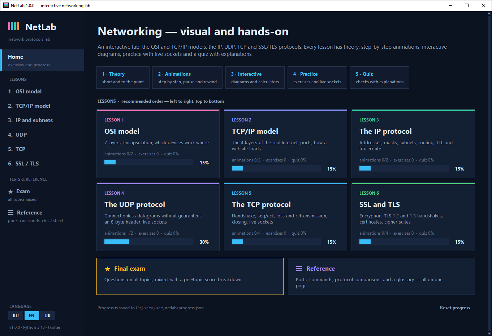
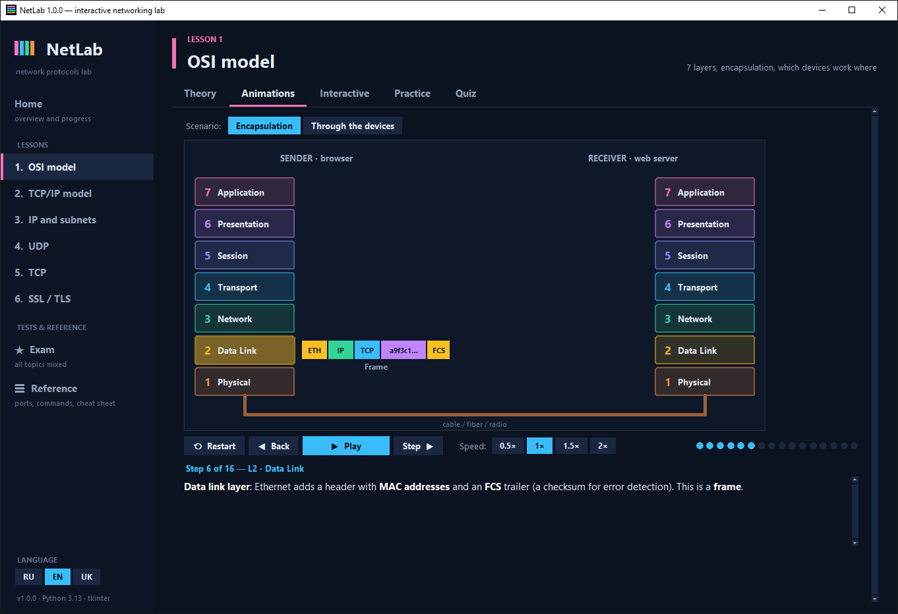
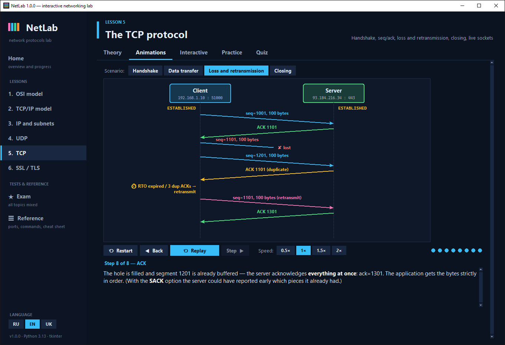
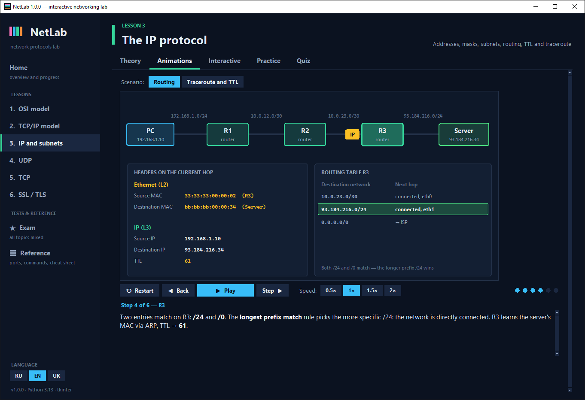
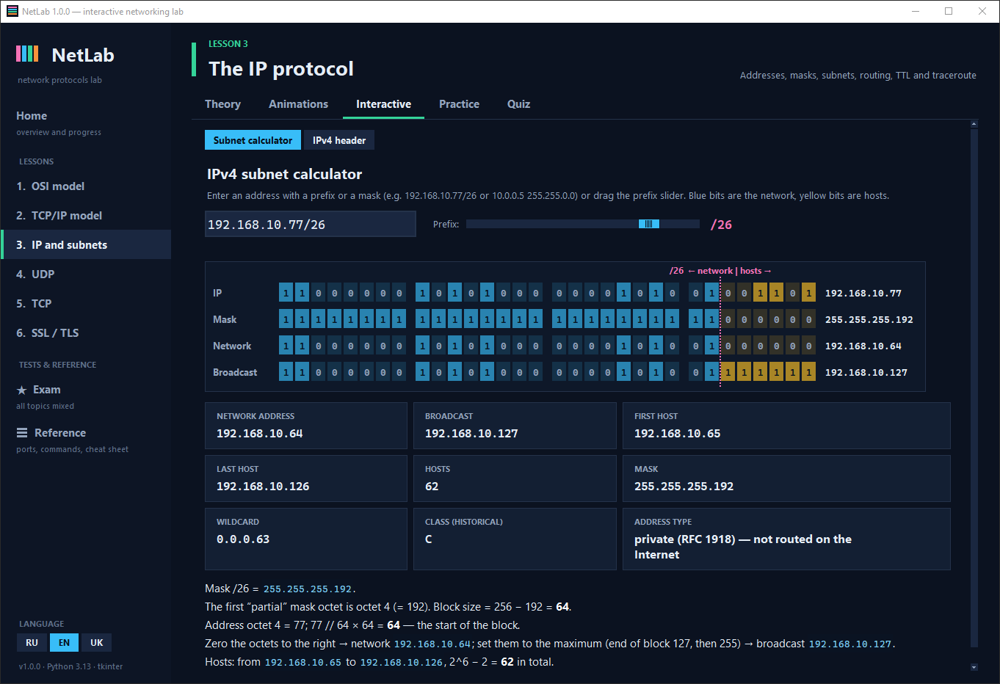
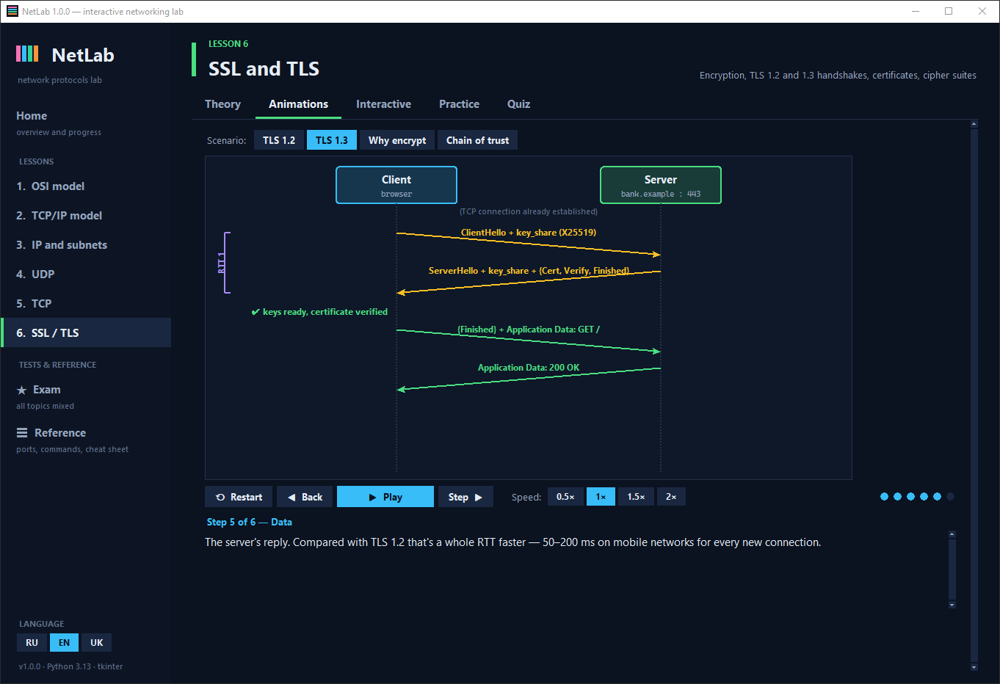
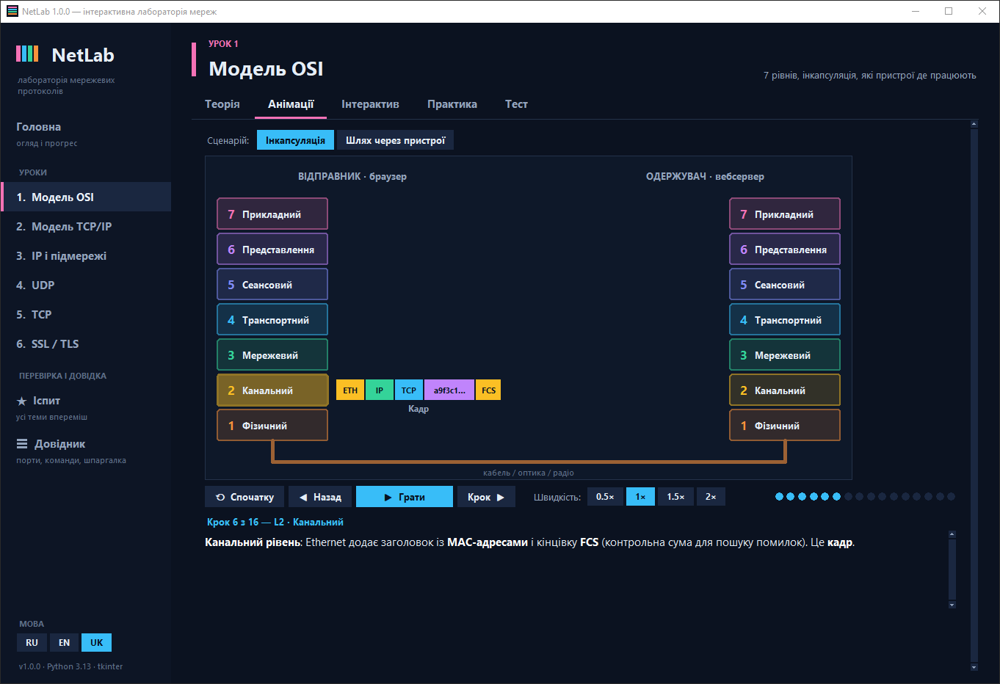

# NetLab — an interactive networking lab

A desktop app for learning computer networks: the **OSI and TCP/IP models** and the **IP, UDP, TCP and SSL/TLS** protocols — with step-by-step animations, interactive diagrams, practice on real sockets and quizzes.

Available in **English, Ukrainian and Russian**. Written in pure Python, no dependencies.



## Features

Each lesson has five parts: **Theory → Animations → Interactive → Practice → Quiz**.

| Lesson | Animations | Interactive | Practice |
|---|---|---|---|
| 1. OSI model | Encapsulation through all 7 layers, the path through a switch and a router | Layer explorer with a postal-mail analogy | “Name the layer” trainer |
| 2. TCP/IP model | OSI ↔ TCP/IP, how a website loads (DNS → TCP → TLS → HTTP) | Protocol map | Port drill |
| 3. IP | Routing (longest prefix match, MAC rewrite, TTL), traceroute | Subnet calculator with a bit map, IPv4 header | Subnets, masks, binary, private addresses |
| 4. UDP | Datagram loss and reordering, DNS over UDP | UDP header, datagram builder with a real checksum | Live UDP echo server with simulated loss |
| 5. TCP | Handshake, seq/ack, loss and retransmission, closing | TCP header, flags calculator | Live TCP server, seq/ack exercises |
| 6. SSL/TLS | TLS 1.2 and 1.3 handshakes, eavesdropping and MITM, certificate chain | Version history, cipher suite decoder | TLS check of a real website, Diffie–Hellman, SHA-256 |

- Animation player with pause, rewind, step-by-step mode and speed control
- Final exam with questions on all topics and a per-topic breakdown
- Reference: ports, networking commands, cheat sheet and glossary
- Progress tracking

| | |
|---|---|
|  |  |
|  |  |
|  |  |

## Getting started

Requires **Python 3.9+** with tkinter (included in the python.org installers for Windows and macOS).

```bash
git clone https://github.com/floridapint/netlab.git
cd netlab
python main.py
```

On Linux you may need to install tkinter first: `sudo apt install python3-tk`.

## Building a Windows .exe

```powershell
py -m pip install pyinstaller
py -m PyInstaller --noconfirm --windowed --name NetLab main.py
```

## License

[MIT](LICENSE)
